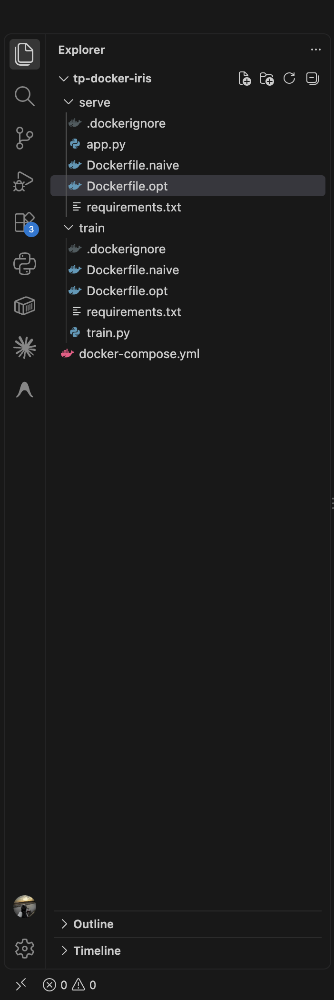
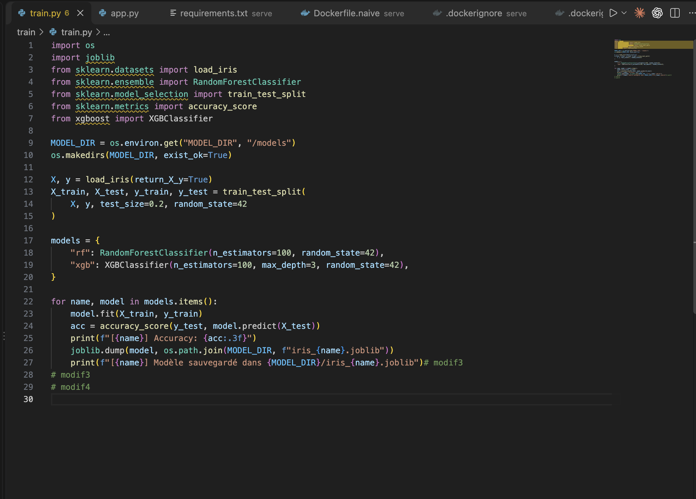
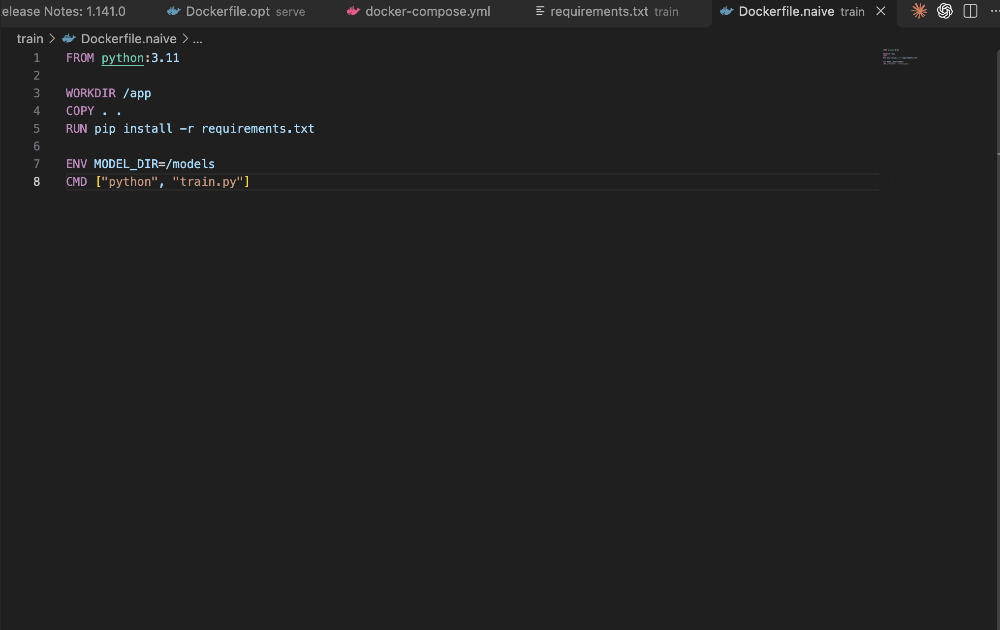
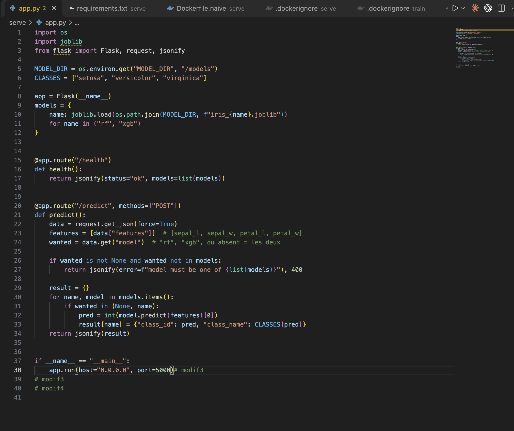
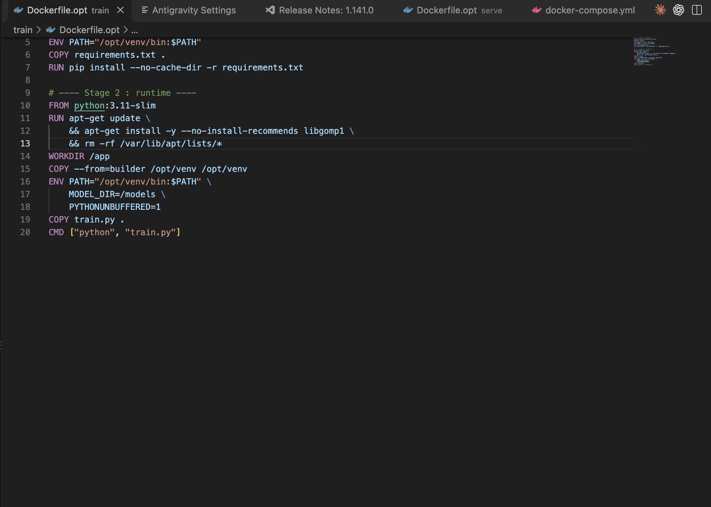
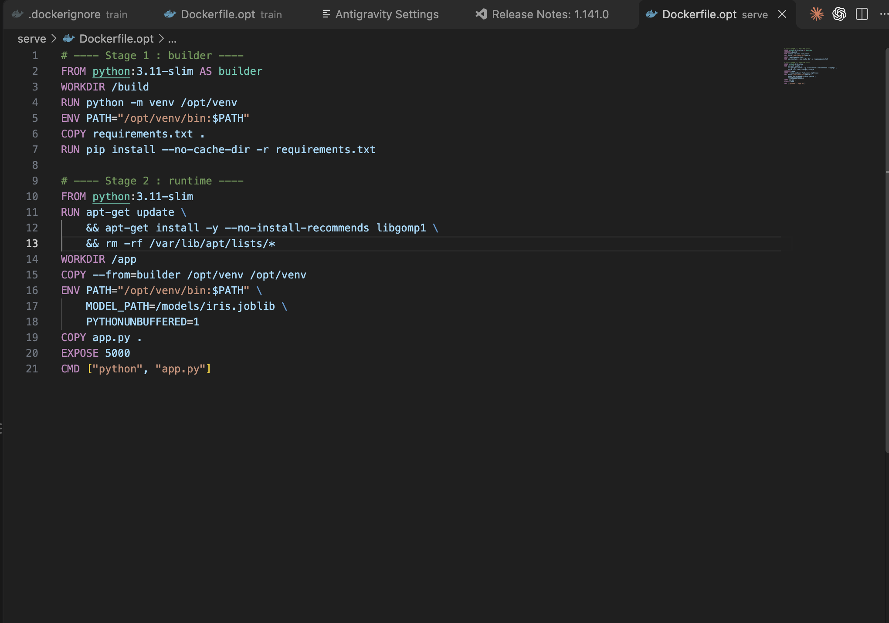
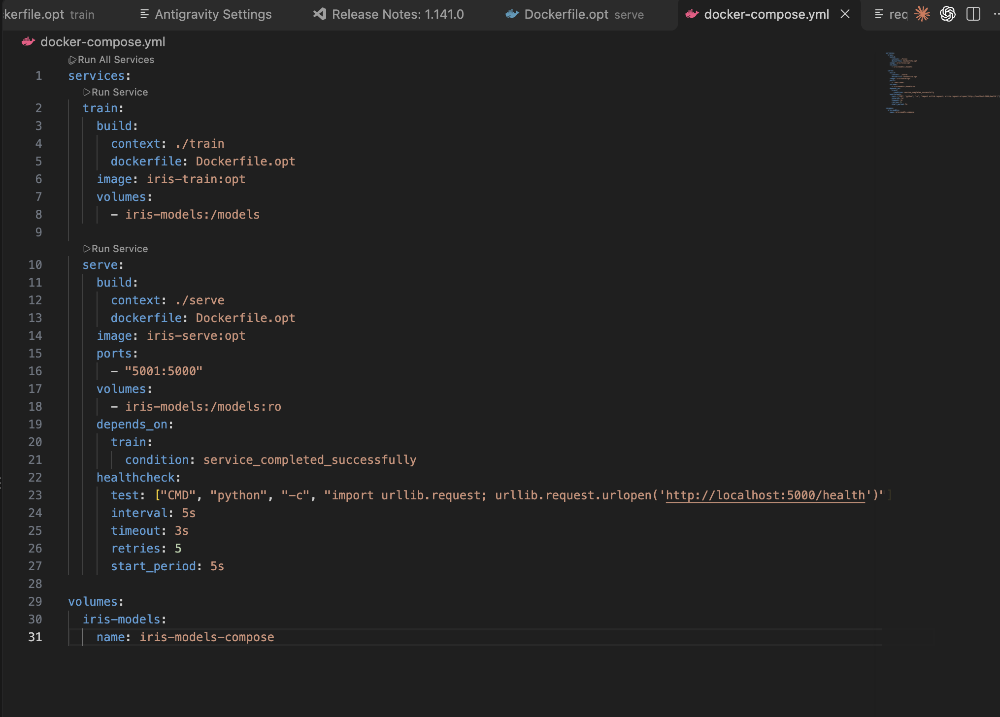

# TP Docker : conteneuriser un modèle et l'optimiser

Cloud & IA, Chapitre 2 : Virtualisation, conteneurisation et Docker.

Ce projet entraîne deux modèles de classification des fleurs « iris » (**Random Forest** et **XGBoost**) dans un conteneur, enregistre les modèles dans un volume Docker, puis les sert via une API Flask dans un second conteneur. Il compare une version **naïve** et une version **optimisée** des images (taille, temps de build), orchestre le tout avec **Docker Compose** et scanne les images avec **Trivy**.

## Sommaire

1. [Objectifs du TP](#objectifs-du-tp)
2. [Structure du projet](#structure-du-projet)
3. [Lancement rapide](#lancement-rapide)
4. [Étape 1 : Dockerfile d'entraînement](#étape-1--dockerfile-dentraînement)
5. [Étape 2 : Dockerfile d'inférence](#étape-2--dockerfile-dinférence)
6. [Étape 3 : mesure de la version naïve](#étape-3--mesure-de-la-version-naïve)
7. [Étape 4 : optimisation](#étape-4--optimisation)
8. [Étape 5 : tableau comparatif](#étape-5--tableau-comparatif)
9. [Étape 6 : orchestration avec Docker Compose](#étape-6--orchestration-avec-docker-compose)
10. [Étape 7 : scan Trivy et correction](#étape-7--scan-trivy-et-correction)
11. [Difficultés rencontrées](#difficultés-rencontrées)
12. [Limites et pistes d'amélioration](#limites-et-pistes-damélioration)

## Objectifs du TP

1. Écrire un Dockerfile d'entraînement produisant un modèle de classification des fleurs « iris » dans un volume.
2. Écrire un Dockerfile d'inférence chargeant ce modèle.
3. Mesurer la version naïve : taille, durée de construction à froid et à chaud.
4. Optimiser : image slim, réordonnancement, `.dockerignore`, multi-étapes.
5. Comparer les deux versions dans un tableau chiffré.
6. Orchestrer entraînement puis inférence avec Docker Compose.
7. Scanner avec Trivy et corriger au moins deux vulnérabilités critiques.

Précision de l'énoncé en cours de TP : deux modèles sont demandés, Random Forest et XGBoost.

## Structure du projet

```
tp-docker-iris/
├── train/
│   ├── .dockerignore
│   ├── Dockerfile.naive      # version naïve
│   ├── Dockerfile.opt        # version optimisée (slim + multi-étapes)
│   ├── requirements.txt
│   └── train.py              # entraîne RF + XGBoost, sauvegarde dans /models
├── serve/
│   ├── .dockerignore
│   ├── Dockerfile.naive
│   ├── Dockerfile.opt
│   ├── requirements.txt
│   └── app.py                # API Flask : /health et /predict
├── docs/img/                 # captures d'écran du rapport
└── docker-compose.yml        # train puis serve, volume partagé
```

Vue dans l'éditeur :



## Lancement rapide

Prérequis : Docker Desktop (ou un démon Docker) et Docker Compose.

```bash
docker compose up --build -d
docker compose ps -a          # train : Exited (0), serve : Up (healthy)
docker compose logs train     # accuracy de chaque modèle
```

Tester l'API (le port hôte est **5001**, voir [Difficultés rencontrées](#difficultés-rencontrées)) :

```bash
# état de l'API et modèles chargés
curl http://localhost:5001/health

# prédiction avec les deux modèles
curl -X POST http://localhost:5001/predict \
  -H "Content-Type: application/json" \
  -d '{"features": [5.9, 3.0, 5.1, 1.8]}'

# prédiction avec un seul modèle ("rf" ou "xgb")
curl -X POST http://localhost:5001/predict \
  -H "Content-Type: application/json" \
  -d '{"features": [5.9, 3.0, 5.1, 1.8], "model": "xgb"}'
```

Les `features` sont `[longueur sépale, largeur sépale, longueur pétale, largeur pétale]`. Un nom de modèle inconnu renvoie une erreur 400.

Arrêt : `docker compose down` (ajouter `-v` pour supprimer aussi le volume).

## Étape 1 : Dockerfile d'entraînement

`train/train.py` entraîne un `RandomForestClassifier` et un `XGBClassifier` sur iris (80 % / 20 %, `random_state=42`), affiche l'accuracy de chaque modèle et sauvegarde `iris_rf.joblib` et `iris_xgb.joblib` dans `MODEL_DIR` (`/models`, monté sur un volume).

Dockerfile naïf (`train/Dockerfile.naive`) :

```dockerfile
FROM python:3.11

WORKDIR /app
COPY . .
RUN pip install -r requirements.txt

ENV MODEL_DIR=/models
CMD ["python", "train.py"]
```

Vérification, avec un volume nommé :

```bash
docker build -f train/Dockerfile.naive -t iris-train:naive train/
docker volume create iris-models
docker run --rm -v iris-models:/models iris-train:naive
docker run --rm -v iris-models:/models alpine ls -lh /models
```

`train/train.py` :



`train/Dockerfile.naive` :



## Étape 2 : Dockerfile d'inférence

`serve/app.py` est une API Flask qui charge les deux modèles au démarrage depuis `/models` et expose :

| Route | Méthode | Rôle |
|---|---|---|
| `/health` | GET | état de l'API et liste des modèles chargés |
| `/predict` | POST | prédiction (`features`, `model` optionnel : `rf`, `xgb` ou les deux) |

Le Dockerfile naïf d'inférence suit le même schéma que celui d'entraînement (`python:3.11`, `COPY . .`, puis `pip install`), avec `EXPOSE 5000`.

```bash
docker build -f serve/Dockerfile.naive -t iris-serve:naive serve/
docker run --rm -d --name iris-api -p 5001:5000 -v iris-models:/models iris-serve:naive
curl http://localhost:5001/health
docker stop iris-api
```

`serve/app.py` :



## Étape 3 : mesure de la version naïve

Méthode :

```bash
# Taille
docker images | grep -E "iris-(train|serve)"

# Build à froid (sans cache)
time docker build --no-cache -f train/Dockerfile.naive -t iris-train:naive train/

# Build à chaud : on modifie le code puis on rebuild avec le cache
echo "# modif" >> train/train.py
time docker build -f train/Dockerfile.naive -t iris-train:naive train/
```

Même procédure pour `serve`. Résultat : le build à chaud est aussi long que le build à froid, car `COPY . .` placé avant `pip install` invalide le cache des dépendances à chaque modification du code.

## Étape 4 : optimisation

Quatre techniques sont appliquées :

| Technique | Mise en œuvre |
|---|---|
| Image slim | `python:3.11-slim` au lieu de `python:3.11` |
| Réordonnancement | `requirements.txt` copié et installé avant le code |
| `.dockerignore` | exclusion de `__pycache__`, `.git`, `.venv`, `*.md`, Dockerfiles |
| Multi-étapes | dépendances installées dans un venv au stage `builder`, seul le venv est copié dans l'image finale |

`train/Dockerfile.opt` :

```dockerfile
# ---- Stage 1 : builder ----
FROM python:3.11-slim AS builder
WORKDIR /build
RUN python -m venv /opt/venv
ENV PATH="/opt/venv/bin:$PATH"
COPY requirements.txt .
RUN pip install --no-cache-dir -r requirements.txt

# ---- Stage 2 : runtime ----
FROM python:3.11-slim
RUN apt-get update \
    && apt-get install -y --no-install-recommends libgomp1 \
    && rm -rf /var/lib/apt/lists/*
WORKDIR /app
COPY --from=builder /opt/venv /opt/venv
ENV PATH="/opt/venv/bin:$PATH" \
    MODEL_DIR=/models \
    PYTHONUNBUFFERED=1
COPY train.py .
CMD ["python", "train.py"]
```

`serve/Dockerfile.opt` est construit de la même façon (il copie `app.py` et ajoute `EXPOSE 5000`).

Note : XGBoost a besoin de la bibliothèque système `libgomp1` (OpenMP), absente de `python:3.11-slim`. Sans elle, l'erreur est `libgomp.so.1: cannot open shared object file`. Le `rm -rf /var/lib/apt/lists/*` est dans le même `RUN` pour ne pas garder le cache apt dans l'image.

```bash
time docker build --no-cache -f train/Dockerfile.opt -t iris-train:opt train/
echo "# modif" >> train/train.py
time docker build -f train/Dockerfile.opt -t iris-train:opt train/
```

`train/Dockerfile.opt` :



`serve/Dockerfile.opt` :



## Étape 5 : tableau comparatif

Mesures faites sur un Mac Apple Silicon (arm64) avec Docker Desktop, une seule mesure par cellule. Les temps à froid dépendent du réseau (téléchargement de `pip install`).

**Version finale (Random Forest + XGBoost)**

| Image | Taille | Build à froid | Build à chaud |
|---|---|---|---|
| `iris-train:naive` | 4,31 Go | 210,6 s | 244,7 s |
| `iris-train:opt` | 1,86 Go | 322,6 s | 2,6 s |
| `iris-serve:naive` | 4,31 Go | 233,6 s | 302,4 s |
| `iris-serve:opt` | 1,86 Go | 667,8 s | 0,4 s |

**Mesures intermédiaires (Random Forest seul, avant l'ajout de XGBoost)**

| Image | Taille | Build à froid | Build à chaud |
|---|---|---|---|
| `iris-train:naive` | 2,12 Go | 35,4 s | 35,1 s |
| `iris-train:opt` | 630 Mo | 41,2 s | 0,4 s |
| `iris-serve:naive` | 2,13 Go | 36,1 s | 42,8 s |
| `iris-serve:opt` | 638 Mo | 39,0 s | 0,4 s |

**Analyse**

- **Taille** : divisée par 2,3 avec XGBoost (4,31 Go vers 1,86 Go) et par 3,4 sans (2,1 Go vers 630 Mo), grâce à `slim` et au multi-étapes.
- **Build à chaud** : de plusieurs minutes (245 à 302 s) à moins de 3 s. Le réordonnancement garde `pip install` en cache tant que `requirements.txt` ne change pas.
- **Build à froid** : pas d'amélioration, voire plus lent. Il est dominé par `pip install`, donc par le réseau. Le 667,8 s de `iris-serve:opt` est une valeur aberrante (même Dockerfile que `iris-train:opt`, 322,6 s), probablement dû au réseau.
- **Poids de XGBoost** : l'ajout du modèle fait passer l'image optimisée de 630 Mo à 1,86 Go. Le paquet `xgboost` installe des bibliothèques GPU NVIDIA (par exemple `nvidia_nccl_cu12`) inutiles pour une inférence sur CPU.

## Étape 6 : orchestration avec Docker Compose

```yaml
services:
  train:
    build:
      context: ./train
      dockerfile: Dockerfile.opt
    image: iris-train:opt
    volumes:
      - iris-models:/models

  serve:
    build:
      context: ./serve
      dockerfile: Dockerfile.opt
    image: iris-serve:opt
    ports:
      - "5001:5000"
    volumes:
      - iris-models:/models:ro
    depends_on:
      train:
        condition: service_completed_successfully
    healthcheck:
      test: ["CMD", "python", "-c", "import urllib.request; urllib.request.urlopen('http://localhost:5000/health')"]
      interval: 5s
      timeout: 3s
      retries: 5
      start_period: 5s

volumes:
  iris-models:
    name: iris-models-compose
```

- `service_completed_successfully` : `serve` ne démarre qu'après la fin réussie de `train`.
- Le volume `iris-models-compose` est neuf : Compose produit lui-même les modèles, sans réutiliser ceux des tests manuels.
- `:ro` : l'inférence monte le volume en lecture seule.
- Le `healthcheck` utilise Python car l'image slim n'a pas `curl`.

Résultat : `train` en `Exited (0)`, `serve` en `Up (healthy)`, et les deux modèles répondent.



## Étape 7 : scan Trivy et correction

Scan (Trivy lancé via Docker, rien à installer) :

```bash
docker run --rm -v /var/run/docker.sock:/var/run/docker.sock \
  aquasec/trivy:latest image --severity CRITICAL iris-serve:naive
```

**Résultats (sévérité CRITICAL)**

| Image | CRITICAL |
|---|---|
| `iris-train:naive` | 16 |
| `iris-serve:naive` | 16 |
| `iris-train:opt` | 0 |
| `iris-serve:opt` | 0 |

**Vulnérabilités critiques de l'image naïve** (toutes au statut `affected`, c'est-à-dire sans correctif Debian disponible) :

| CVE | Paquet(s) | Nature |
|---|---|---|
| CVE-2026-44172 | `libmariadb-dev`, `libmariadb3`, `mariadb-common` | injection SQL (MariaDB) |
| CVE-2026-49261 | `libmariadb-dev`, `libmariadb3`, `mariadb-common` | exécution de code (MariaDB) |
| CVE-2026-42216 | `libopenexr-3-1-30`, `libopenexr-dev` | fuite d'information, déni de service (OpenEXR) |
| CVE-2026-42217 | `libopenexr-3-1-30`, `libopenexr-dev` | fuite d'information (EXR malformé) |
| CVE-2026-6653 | `libxml2` | déni de service |
| CVE-2026-43185 | `linux-libc-dev` | noyau (ksmbd) |
| CVE-2026-60002 | `openssh-client` | use-after-free |

Le total de 16 compte les couples (paquet, CVE).

**Correction** : aucune mise à jour n'existe pour ces CVE, donc la correction consiste à **retirer les paquets vulnérables**. L'image complète `python:3.11` embarque des outils de développement (MariaDB, OpenEXR, client SSH, en-têtes noyau) dont l'application n'a pas besoin. Le passage à `python:3.11-slim` avec un build multi-étapes les supprime, et le scan de l'image optimisée ne remonte plus aucune vulnérabilité critique.

Preuve que les paquets sont absents de l'image optimisée et présents dans la naïve :

```bash
# image optimisée : aucune ligne (grep ne trouve rien)
docker run --rm --entrypoint sh iris-serve:opt -c \
  "dpkg -l | grep -E 'mariadb|openexr|libxml2|linux-libc-dev|openssh-client'"

# image naïve : les paquets sont listés
docker run --rm --entrypoint sh iris-serve:naive -c \
  "dpkg -l | grep -E 'mariadb|openexr|libxml2|linux-libc-dev|openssh-client'"
```

Sur l'image optimisée, la première commande n'affiche rien et Docker Desktop affiche un bandeau « Debug this container error with Gordon » : ce n'est pas une erreur, `grep` renvoie simplement le code 1 quand il ne trouve rien.

## Difficultés rencontrées

- **Port 5000 occupé sur macOS** : le service AirPlay Receiver utilise ce port (`bind: address already in use`). L'API est donc publiée sur le port hôte **5001** (`-p 5001:5000`).
- **`curl` juste après `docker run -d`** : `Connection reset by peer`, car Flask n'avait pas fini de démarrer (import de scikit-learn et chargement du modèle). Il faut attendre 2 à 3 s, ou utiliser le `healthcheck` de Compose.
- **XGBoost dans l'image slim** : erreur `libgomp.so.1` corrigée en installant `libgomp1` dans le stage runtime.
- **Builds très longs avec XGBoost** : environ 3 à 5 min en naïf, jusqu'à 11 min pour une mesure à froid, à cause de la taille des dépendances.

## Limites et pistes d'amélioration

- L'image optimisée n'a plus de vulnérabilité critique, mais le scan `CRITICAL,HIGH` de `iris-serve:opt` remonte encore 52 vulnérabilités HIGH (48 paquets Debian, 4 paquets Python). La plupart n'ont pas de correctif Debian disponible.
- Quelques HIGH ont un correctif : OpenSSL (CVE-2026-84782, version `3.5.7-1~deb13u3`), pcre2 (CVE-2026-103111, version `10.46-1~deb13u3`), ainsi que `jaraco.context` (CVE-2026-23949) et `wheel` (CVE-2026-24049), embarqués dans `setuptools`. Un `apt-get upgrade` et la désinstallation de `setuptools` et `wheel` dans l'image finale les traiteraient.
- Les temps sont des mesures uniques sur une machine, sensibles au réseau. Pour un résultat plus rigoureux, répéter chaque mesure et prendre la moyenne.
- Le serveur Flask de développement (`app.run`) n'est pas adapté à la production : un serveur WSGI comme gunicorn serait préférable.
- Le paquet `xgboost` embarque des bibliothèques GPU inutiles pour de l'inférence CPU, ce qui alourdit l'image.
